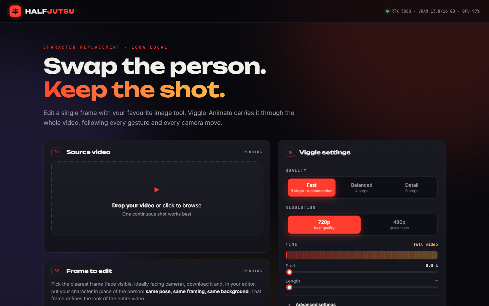
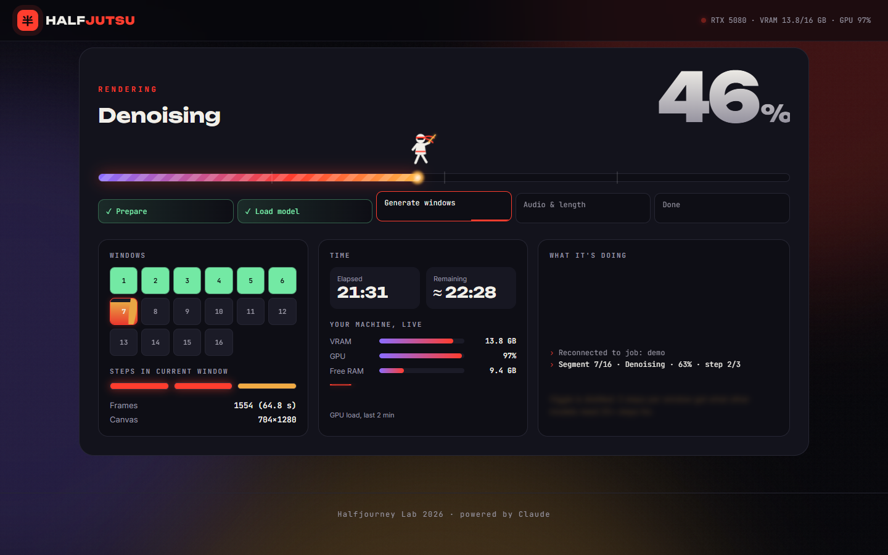
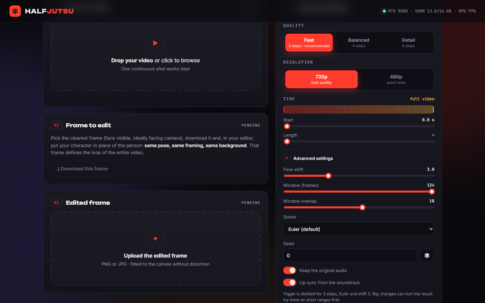

# Halfjutsu

**Local character replacement in video, on a 16 GB consumer GPU.**
Edit *one* frame of your video with any image tool, putting your character in place of
the person. Halfjutsu carries that edit through the whole clip with
[Viggle-Animate](https://huggingface.co/Viggle/Viggle-Animate), following every gesture,
camera move and (optionally) the mouth movement of the soundtrack. Everything runs on your
own PC: no cloud, no uploads.

> Tested on **one** configuration: Windows 11, RTX 5080 16 GB, 32 GB RAM. Other 16 GB+
> NVIDIA cards (4080, 4090, 5090, …) should work but have not been tested.

---

## What you need

| | Minimum | Tested |
|---|---|---|
| OS | Windows 10/11 64-bit | Windows 11 Pro |
| GPU | NVIDIA, **16 GB VRAM** | RTX 5080 16 GB |
| Driver | 580 or newer (CUDA 13) | 610.88 |
| RAM | 32 GB | 32 GB |
| Free disk | ~60 GB | |
| Internet | ~30 GB to download once | |

Cards with less than 16 GB are **not** supported; the installer checks this and stops.

## Install (one click)

1. **Download** this repository: green *Code* button → *Download ZIP*, and unzip it to a
   folder with plenty of space and **no spaces or accents in the path**, e.g. `D:\halfjutsu`.
   (Or `git clone` it.)
2. **Double-click `install.bat`.** It:
   1. checks your GPU, VRAM and driver;
   2. installs Git and [uv](https://docs.astral.sh/uv/) if missing;
   3. downloads WanGP pinned to the tested version;
   4. creates a private Python 3.11 environment with PyTorch 2.10 (CUDA 13),
      SageAttention 2 and the WanGP kernels;
   5. shows the **model licence** and asks you to type `I AGREE`;
   6. downloads the Viggle-Animate weights (~26 GB, checksum-verified, resumable);
   7. puts a **Halfjutsu** shortcut on your desktop.
3. Wait 30–90 minutes (mostly the download). If anything stops, **run `install.bat`
   again**: it skips what is done and resumes downloads.

Everything stays inside the folder (plus the shortcut, Git and uv). To uninstall, delete
the folder and the shortcut.

## Use

Start **Halfjutsu** (desktop icon or `start_halfjutsu.bat`). Your browser opens
<http://127.0.0.1:8787>.

1. **Source video** – drag it in. One continuous shot works best (see below).
2. **Frame to edit** – scrub to the clearest frame (the time code matches Photoshop at
   24 fps) and click *Download this frame*.
3. **Edit that frame** in your image tool (Photoshop, an AI image editor, …): replace the
   person with your character, keeping **the same pose, framing, background and size**.
   This single image decides how the character looks in the whole video.
4. **Upload the edited frame**, check the before/after, and click **Generate**.
5. Watch the live progress (windows, steps, VRAM, ETA). Download the result when it ends.
   You can close the tab: reopening the page reconnects to the running job.

Progress screen of a long render (values simulated for the screenshot).

### Which videos work (and which don't)

Viggle propagates **one** edited frame; anything not in that frame is improvised. Avoid:

- **objects that appear/disappear on the person** (putting on glasses, a cap, a jacket, an
  object picked up later);
- **cuts / shot changes** – trim to a single shot;
- **subtitles, captions, logos, watermarks** – use the clean version;
- **people entering or leaving**, elements added or removed mid-clip;
- **big turns** (front → back): pick the most representative frame with the time code.

Works best: one continuous shot, one clearly visible person, steady light, no overlay text.

### Settings

The defaults are the recommended values (they match Viggle's official recipe).

| Setting | Default | Notes |
|---|---|---|
| Resolution | 720p | 480p is ~2× faster and softer |
| Steps | 3 | The model is distilled for 3; more steps over-sharpen |
| Lip sync | on | Uses the soundtrack to drive the mouth (experimental in Viggle) |
| Keep original audio | on | |
| Start / duration | whole clip | Render only part of the video |
| Shift, solver, window, overlap, seed | 3, euler, 124, 18, 0 | Advanced; leave them unless you know why |

### Long videos

Viggle generates 124-frame windows (5.2 s). Chaining windows (each continuing from the
previous one's generated frames) **degrades the image visibly after ~8 s** – we measured
detail noise rising from 14 to 45 over 64 s. So clips longer than 5.2 s are split into
**independent 5.2 s chunks, all made from your edited frame**: nothing accumulates, the
last chunk looks as good as the first. Neighbouring chunks share 1 s; Halfjutsu cuts where
the two versions look most alike and eases the colour for 1 s after the cut (no
cross-fade, so no ghosting). A cut is roughly as visible as one frame of fast motion.

Approaches we tried and rejected (details in [`docs/LONG_VIDEOS.md`](docs/LONG_VIDEOS.md)):
cleaning the carried-over frames, chaining the reference frame, and cross-fades.

### How long it takes (RTX 5080, 720p)

| Clip | Time |
|---|---|
| 3 s | ~4 min (includes loading the model) |
| 5 s | ~4 min |
| 20 s | ~17 min |
| 60 s | ~55 min |

About 3.5 minutes per 5-second chunk. A long render that is interrupted resumes from the
chunks already made.

## Troubleshooting

| Problem | Fix |
|---|---|
| *No NVIDIA driver / driver too old* | Install the latest driver from <https://www.nvidia.com/drivers> |
| *PyTorch cannot use the GPU* | Update the driver, reboot, run `install.bat` again |
| Download stops or is slow | Run `install.bat` again; it resumes |
| *Viggle weights are missing* | The download did not finish: run `install.bat` |
| Out of memory during a render | Close other GPU apps (games, browsers with video, other AI tools) and try 480p |
| The browser page does not open | Open <http://127.0.0.1:8787> by hand while the black window is open |
| Port 8787 already in use | Close the other Halfjutsu window |
| Result looks wrong (extra objects, warped text) | See *Which videos work*; improve the edited frame |

### Installing with Claude Code (optional)

If something fails on your machine, open the folder with
[Claude Code](https://claude.com/claude-code) and ask it to install or fix Halfjutsu. The
[`CLAUDE.md`](CLAUDE.md) file gives it the technical context (pinned versions, frame grid,
known pitfalls). This is optional; `install.bat` works on its own.

## Licences – please read

- **Halfjutsu's own code** (this repository): [MIT](LICENSE).
- **WanGP** (downloaded by the installer, not included here):
  [WanGP Community License](https://github.com/deepbeepmeep/WanGP/blob/main/LICENSE.txt) –
  free to use, not to sell or embed in paid products.
- **Viggle-Animate / MiniMax H3 weights** (downloaded by you, not included here): their own
  licence on the [model page](https://huggingface.co/Viggle/Viggle-Animate). Its standard
  grant **excludes some regions (among them the EU, UK, USA and South Korea)**. You are
  responsible for checking that you may use the model where you live and for what you do.

Halfjutsu does not redistribute any model weights.

## Responsible use

This tool replaces a real person in a video. Use it only with footage you have the right
to use and with the **consent** of the people who appear in it. Do not use it to
impersonate anyone, to deceive, or for sexual or harassing content. Label results as
AI-generated when you publish them.

## Credits

- [Viggle-Animate](https://huggingface.co/Viggle/Viggle-Animate) by Viggle, built on MiniMax H3.
- [WanGP](https://github.com/deepbeepmeep/WanGP) by DeepBeepMeep – the model runtime and the
  pruned INT8 weights that make 16 GB possible.
- [SageAttention](https://github.com/thu-ml/SageAttention), [PyTorch](https://pytorch.org), [uv](https://docs.astral.sh/uv/).

Halfjourney Lab 2026 · built with [Claude Code](https://claude.com/claude-code).
